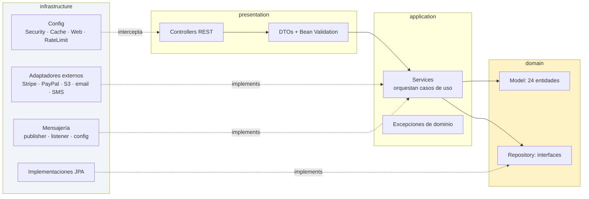
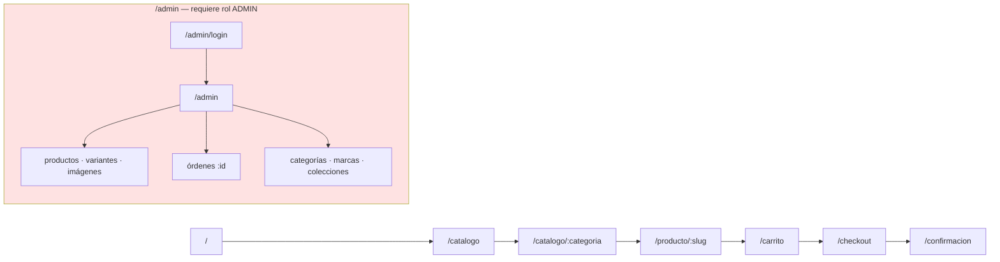
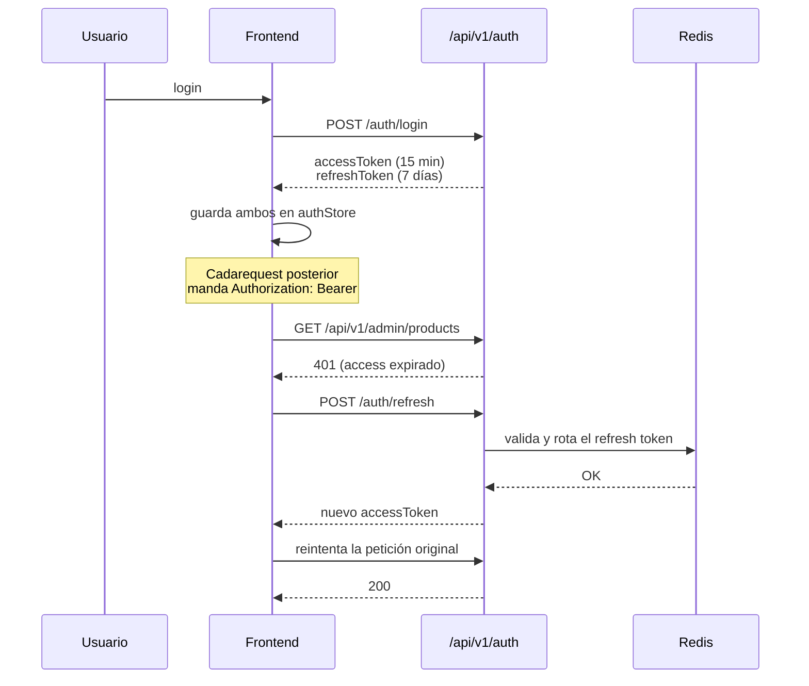
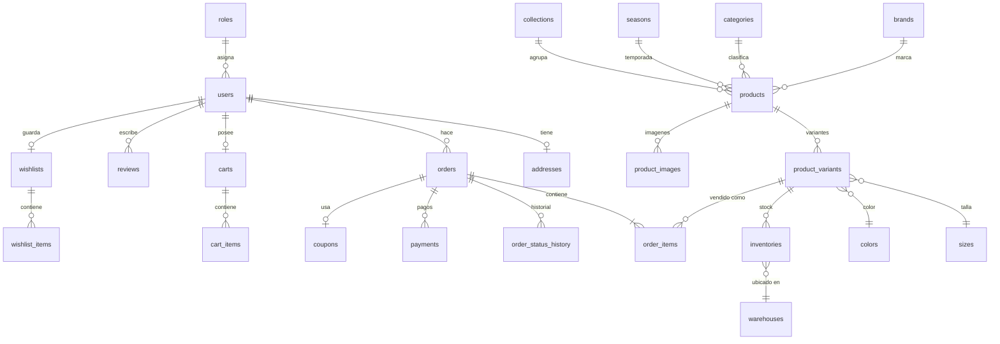
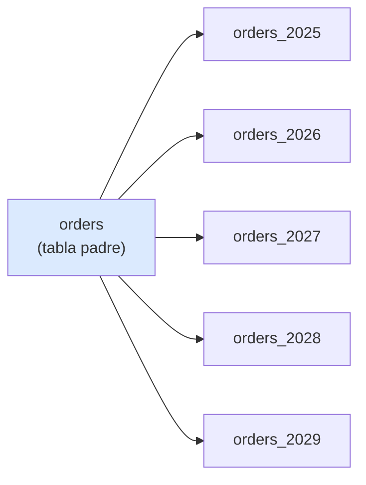

<div align="center">

# MAISON

### Tienda de moda premium — React 19 + Spring Boot 3

E-commerce de moda con catálogo, carrito, checkout, autenticación con refresh token,
panel de administración y backend hexagonal con PostgreSQL, Redis y RabbitMQ.

[Stack](#stack) · [Arquitectura](#arquitectura) · [Arranque rápido](#arranque-rápido) · [API](#api)

</div>

---

## Índice

1. [Qué es este proyecto](#qué-es-este-proyecto)
2. [Stack](#stack)
3. [Arquitectura](#arquitectura)
4. [Estructura del repositorio](#estructura-del-repositorio)
5. [Frontend](#frontend)
6. [Backend](#backend)
7. [Base de datos](#base-de-datos)
8. [API](#api)
9. [Seguridad](#seguridad)
10. [Arranque rápido](#arranque-rápido)
11. [Variables de entorno](#variables-de-entorno)
12. [Build y tests](#build-y-tests)
13. [Cómo se construyó](#cómo-se-construyó)
14. [Notas de seguridad](#notas-de-seguridad)

---

## Qué es este proyecto

MAISON es una tienda de moda online construida como aplicación full-stack. El
frontend es una SPA de React con Vite y Tailwind; el backend es una API REST
sobre Spring Boot 3 con arquitectura hexagonal (puertos y adaptadores).

Lo que hace:

- **Catálogo** con filtros por categoría y ficha de producto con variantes
  (talla, color), selector de cantidad y quick view.
- **Carrito y checkout** con stepper, cálculo de envío y página de confirmación.
- **Autenticación** de clientes y administradores con access + refresh token,
  rotación y revocación del refresh token en Redis.
- **Panel de administración** para productos (con variantes e imágenes), órdenes
  con máquina de estados, categorías, marcas y colecciones.
- **Wishlist** lateral, sincronizada con el usuario autenticado.
- **Integraciones**: Stripe, PayPal, Cloudinary, SMTP y RabbitMQ para eventos.

---

## Stack

| Capa | Tecnología | Versión |
|---|---|---|
| **Frontend** | React | 19.2 |
| | TypeScript | 5.9 |
| | Vite | 7.2 |
| | Tailwind CSS | 3.4 |
| | Zustand (estado) | 5.0 |
| | Framer Motion | 12.4 |
| | GSAP + Lenis | 3.15 / 1.3 |
| | React Hook Form + Zod | 7.7 / 4.3 |
| **Backend** | Spring Boot | 3.2.1 |
| | Java | 17 |
| | Spring Security + JWT | — |
| | Spring Data JPA / Hibernate | — |
| **Datos** | PostgreSQL | 16 (Flyway) |
| | Redis | 7 (cache + refresh tokens) |
| | RabbitMQ | 3 (eventos) |
| **Infra** | Docker Compose | — |
| | Maven | — |

---

## Arquitectura

### Vista general

```mermaid
graph TB
    subgraph Cliente["Navegador"]
        UI["React SPA<br/>Vite + Tailwind"]
    end

    subgraph FE["Frontend — capa de presentación"]
        R["React Router<br/>rutas públicas y /admin"]
        S["Zustand<br/>carrito · auth · UI · wishlist"]
    end

    subgraph BE["Backend — API REST :8080"]
        C["Controllers<br/>/api/v1/**"]
        APP["Services<br/>casos de uso"]
        DOM["Domain<br/>entidades y contratos"]
        SEC["Security<br/>JWT · RBAC · rate limit"]
    end

    subgraph INF["Infraestructura"]
        PG[("PostgreSQL 16<br/>34 tablas · particionado")]
        RD[("Redis 7<br/>cache + refresh tokens")]
        MQ["RabbitMQ 3<br/>eventos de dominio"]
        EXT["Stripe · PayPal<br/>Cloudinary · SMTP"]
    end

    UI --> R
    R --> S
    S -- "REST + JWT" --> C
    C --> SEC
    C --> APP
    APP --> DOM
    APP --> PG
    APP --> RD
    APP --> MQ
    APP --> EXT

    style FE fill:#f5f3ff
    style BE fill:#eff6ff
    style INF fill:#f0fdf4
```



### Arquitectura hexagonal del backend

El backend sigue **puertos y adaptadores**: el dominio no depende de nada
externo, y lo que necesita del exterior se declara como puertos.



**Regla de dependencia:** las flechas apuntan hacia adentro. `domain` no importa
nada de `infrastructure`; el cableado real se hace en la capa `infrastructure`
mediante inyección de dependencias de Spring.

---

## Estructura del repositorio

```
.
├── src/                    # Frontend (SPA React)
│   ├── components/
│   │   ├── admin/          # Layout, editores de variantes e imágenes, guard
│   │   ├── auth/           # Modal de login y registro
│   │   ├── cart/           # MiniCart
│   │   ├── layout/         # Header (mega menú) y Footer
│   │   ├── product/        # ProductCard, QuickView, Selectors
│   │   └── wishlist/       # Drawer de wishlist
│   ├── hooks/              # useApi, use-mobile
│   ├── lib/                # api.ts, adminApi.ts, animations, data, utils
│   ├── pages/              # Home, Catalogo, Producto, Carrito, Checkout…
│   │   └── admin/          # Productos, órdenes, categorías, marcas…
│   ├── stores/             # Zustand: auth, cart, ui
│   ├── App.tsx             # Rutas
│   └── main.tsx            # Bootstrap: Lenis + GSAP
├── public/images/          # Recursos servidos como /images/**
├── backend/                # API Spring Boot
│   ├── src/main/java/com/fashion/ecommerce/
│   │   ├── presentation/   # Controllers y DTOs
│   │   ├── application/    # Servicios y excepciones
│   │   ├── domain/         # Entidades e interfaces de repositorio
│   │   ├── infrastructure/ # JPA, seguridad, externos, mensajería
│   │   └── config/
│   ├── src/main/resources/
│   │   ├── application-dev.yml
│   │   └── db/migration/   # Flyway V1..V3
│   └── src/test/           # 18 clases de test
├── docker-compose.yml      # Postgres + Redis + RabbitMQ + backend
├── .env.example            # Plantilla de variables de entorno
└── package.json
```

---

## Frontend

### Navegación



`RequireAdmin` bloquea el árbol admin si no hay access token válido **y** el
usuario tiene rol `ADMIN`: un token de cliente no alcanza.

### Estado

Cuatro stores de Zustand, separados por responsabilidad:

| Store | Responsabilidad |
|---|---|
| `authStore` | Sesión: access token, refresh token, usuario y roles |
| `cartStore` | Carrito, totales y cálculo de envío |
| `uiStore` | Drawers, modales y toasts |
| `wishlist` | Favoritos del usuario autenticado |

`adminApi.ts` envuelve las llamadas de administración: adjunta el header
`Bearer`, y ante un `401` **una sola vez** refresca el token y reintenta la
petición original. El refresh se deduplica con `refreshInFlight`, así dos
llamadas simultáneas en `401` disparan un único refresh.

---

## Backend

### Capas

| Paquete | Responsabilidad |
|---|---|
| `presentation` | 13 controllers REST, DTOs y validación con Bean Validation |
| `application` | 10 services que orquestan los casos de uso |
| `domain` | 24 entidades y las interfaces de repositorio |
| `infrastructure` | JPA, seguridad, adaptadores externos y mensajería |

### Seguridad



El refresh token vive en Redis (`RedisRefreshTokenStore`), lo que permite
revocarlo: si un token fue rotado, el anterior deja de servir. Un
`IdempotencyFilter` evita que un reintento de pago se procese dos veces.

---

## Base de datos

36 tablas definidas en migraciones Flyway (31 tablas base más 5 particiones de
`orders`). `V1__initial_schema.sql` es la fuente de verdad: JPA corre con
`ddl-auto: none`, así que el esquema nunca se deriva de las entidades.

### Catálogo y pedidos



### Particionado de órdenes



`orders` está particionada por rango sobre `order_year`. Es la tabla que más
crece y la que más se consulta por fecha, así que acotar cada búsqueda a un
año mantiene los índices en caliente. Al pasar 2029 hay que crear la partición
del año siguiente antes del 31 de diciembre.

### Migraciones

| Versión | Contenido |
|---|---|
| `V1__initial_schema.sql` | Esquema completo (1011 líneas, 36 tablas) |
| `V2__maison_seed.sql` | Datos iniciales del catálogo |
| `V3__admin_filter_index.sql` | Índices para filtros del panel admin |

---

## API

Base: `/api/v1`. Formato JSON, fechas `yyyy-MM-dd HH:mm:ss`, zona
`America/Lima`.

### Público

| Método | Ruta | Descripción |
|---|---|---|
| POST | `/auth/login` | Inicia sesión |
| POST | `/auth/register` | Registra un cliente |
| POST | `/auth/refresh` | Rota el refresh token |
| GET | `/products` | Lista con filtros y paginación |
| GET | `/products/{id}` | Ficha de producto |
| GET | `/categories`, `/brands` | Taxonomía |
| POST | `/checkout` | Crea la orden |
| POST | `/webhook/stripe` | Webhook de pago |

### Requiere `ADMIN`

| Método | Ruta | Descripción |
|---|---|---|
| GET/POST/PUT/DELETE | `/admin/products[/{id}]` | CRUD de productos |
| POST | `/admin/products/{id}/publish\|unpublish` | Publicación |
| GET | `/admin/orders[/{id}]` | Listado y detalle |
| POST | `/admin/orders/{id}/status` | Transición de estado |
| GET/POST/PUT/DELETE | `/admin/categories`, `/admin/brands`, `/admin/collections` | Catálogo |
| POST | `/admin/images` | Subida de imágenes |

### Monitoreo

`/actuator/health`, `/actuator/info`, `/actuator/metrics` y
`/actuator/prometheus` en el puerto **8081**, separado del de la API (8080).

---

## Seguridad

**Modelo:** JWT stateless con refresh token en Redis, stateless
(`SessionCreationPolicy.STATELESS`), BCrypt para contraseñas, CORS restricted
a los orígenes de `ALLOWED_ORIGINS`.

**Control de acceso:**

| Ruta | Regla |
|---|---|
| `/api/v1/auth/**`, `/products/**`, `/categories/**`, `/brands/**`, `/checkout/**`, `/orders/**`, `/webhook/**` | Público |
| `/api/v1/admin/**` | Rol `ADMIN` |
| `/api/v1/management/**` | Rol `ADMIN` o `MANAGER` |
| Resto | Autenticado |

**Rate limiting:** 100 req/60 s por IP en general; 5 intentos de login cada
15 minutos.

**Credenciales:** ninguna está en el código. Todo pasa por variables de
entorno con `${VAR}` **sin valor por defecto**, así que la aplicación falla al
arrancar en vez de conectarse con una clave conocida. `.env` está en
`.gitignore`; `.env.example` documenta cada variable.

> **Sobre los tests:** en `backend/src/test/` vas a ver literales como
> `postgres123` o `Admin@2026!`. Son fixtures de **Testcontainers**: Postgres,
> Redis y RabbitMQ efímeros que se crean y se destruyen en cada corrida. No
> apuntan a ningún sistema real y no sirven para autenticarse en nada. La
> diferencia con la configuración real es que `application-dev.yml` ya no
> tiene ningún valor por defecto.

---

## Arranque rápido

### Requisitos

- Docker + Docker Compose
- Java 17 y Maven (el proyecto no incluye el wrapper `mvnw`)
- Node 20.19+ (mínimo que pide Vite 7)

### 1. Configurar el entorno

```bash
cp .env.example .env
```

Generá las claves que faltan:

```bash
openssl rand -base64 48   # para JWT_SECRET
```

### 2. Levantar la infraestructura

```bash
docker compose up -d postgres redis rabbitmq
```

Comprueba que estén sanos con `docker compose ps`. Si falta alguna variable,
el comando falla con un mensaje explícito en vez de usar valores por defecto.

### 3. Levantar el backend

```bash
cd backend
mvn spring-boot:run
```

API en `http://localhost:8080`, actuator en `http://localhost:8081`.

### 4. Levantar el frontend

```bash
npm install
npm run dev
```

App en `http://localhost:5173`.

---

## Variables de entorno

Todas están documentadas con comentarios en [`.env.example`](.env.example).
Las **requeridas** son:

| Variable | Para qué |
|---|---|
| `POSTGRES_PASSWORD` / `DB_PASSWORD` | Base de datos |
| `REDIS_PASSWORD` | Redis |
| `RABBITMQ_PASSWORD` | RabbitMQ |
| `JWT_SECRET` | Firma de tokens (mín. 32 bytes) |

Las integraciones externas (Stripe, PayPal, Cloudinary, SMTP) van vacías por
omisión y la integración queda desactivada hasta que las llenes.

`ADMIN_DEFAULT_PASSWORD` merece atención: si la definís, el arranque codifica
esa contraseña con BCrypt(12) y la aplica a `admin@fashion.com`. Está vacío por
omisión justamente para no publicar una contraseña de admin conocida. Si lo
usás, cambiala después del primer inicio de sesión.

---

## Build y tests

```bash
# Frontend
npm install
npm run dev        # servidor de desarrollo
npm run build      # tsc -b && vite build
npm run lint
npm run preview    # sirve el build de producción

# Backend
cd backend
mvn test                   # tests
mvn spring-boot:run       # servidor
```

> El proyecto no incluye el wrapper de Maven (`mvnw`), así que necesitás Maven
> instalado en el `PATH`.

---

## Cómo se construyó

El proyecto se developed por **slices** (porciones verticales), cada uno
entregable de punta a punta en lugar de construir por capas y esperar al final:

| Slice | Qué agregó |
|---|---|
| S1 | Stack local: Postgres, Redis, RabbitMQ y base del backend |
| Catálogo | Entidades, repositorios, migraciones y seed del catálogo |
| Storefront | React, Vite, Tailwind y los stores de carrito/UI |
| Carrito y checkout | Flujo de compra con stepper y confirmación |
| Auth | Login y registro con JWT y refresh token en Redis |
| Admin catálogo | CRUD de productos, categorías, marcas y colecciones |
| Admin órdenes | Listado, detalle y máquina de estados de órdenes |
| Imágenes | Subida multipart, imagen principal y borrado |

Los commits siguen una convención por slice (`feat(admin-orders): …`,
`test(admin-orders): …`), separando siempre la implementación del test para que
el historial se lea como narrativa del avance.

---

## Notas de seguridad

Estas son dos cosas que conviene endurecer antes de desplegar en producción.
No están resueltas en el código a propósito: son decisiones de despliegue.

**1. Actuator expone endpoints sensibles.**
`management.endpoints.web.exposure.include` incluye `env`, `configprops` y
`heapdump`, y `SecurityConfig` deja `/actuator/**` como `permitAll()`. En un
entorno accesible desde internet eso permite leer la configuración resuelta
—incluidos secretos— y descargar un volcado de heap. Restringí el actuator a
la red interna o exponé solo `health`, `info` y `prometheus`.

**2. `ddl-auto: none` es deliberado.**
Las entidades JPA todavía se desvan del DDL escrito a mano en `V1__initial_schema.sql`
(por ejemplo `User.role` contra `users.role_id`). Flyway es la fuente de verdad
del esquema y `validate-on-migrate` verifica la integridad. Si cambiás las
entidades, escribí la migración nueva; no dejes que Hibernate genere el esquema.

---

<div align="center">

**MAISON** — Tienda de moda premium

</div>